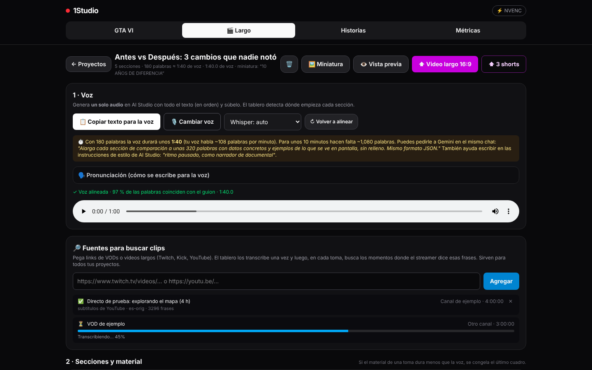
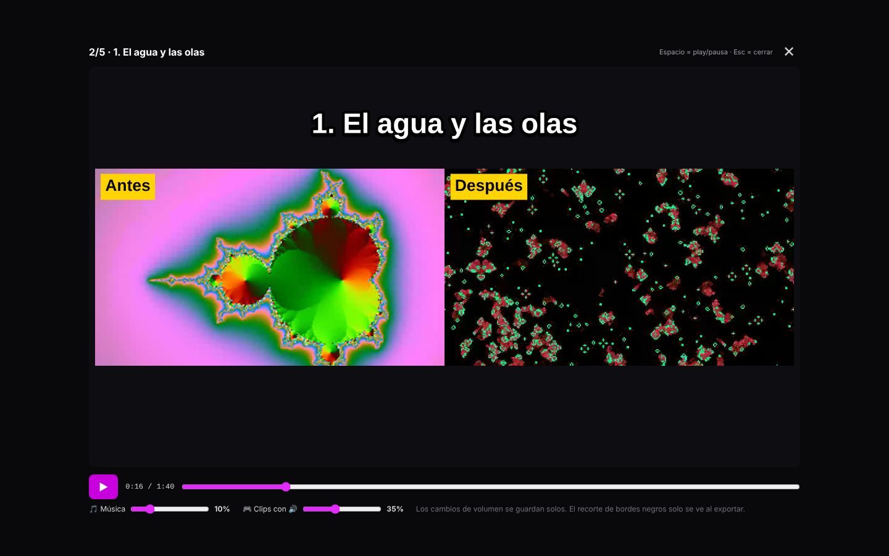
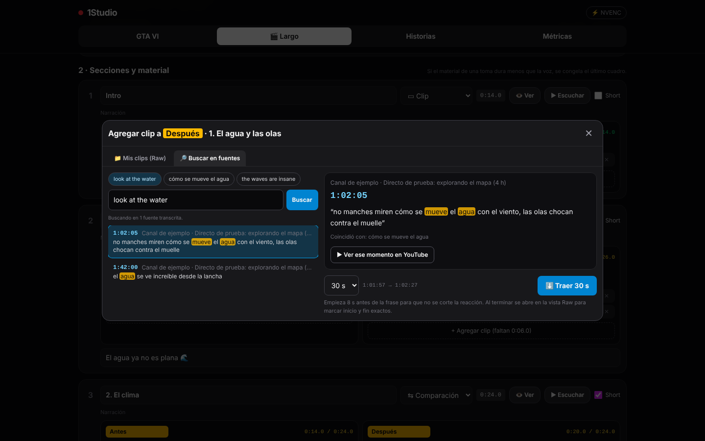
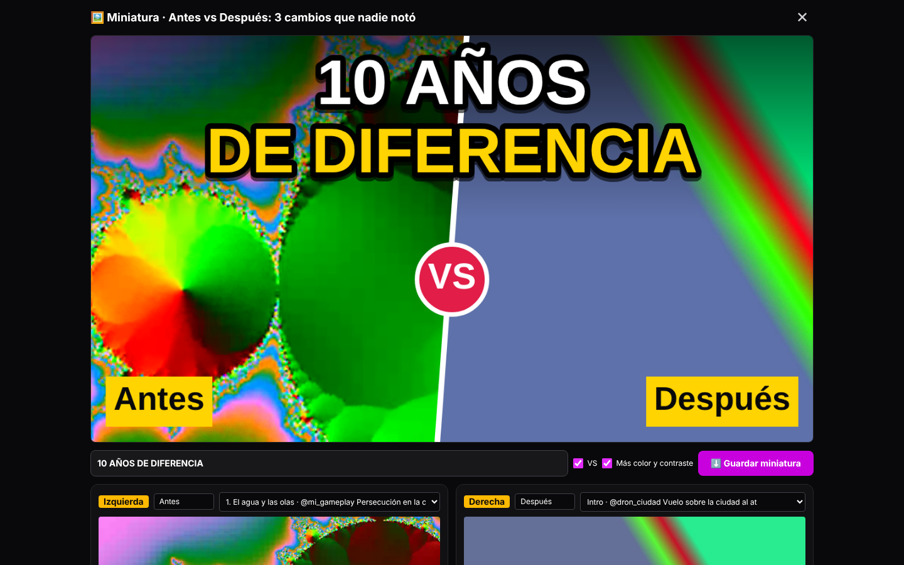
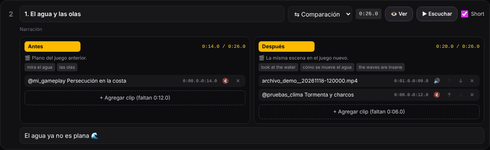
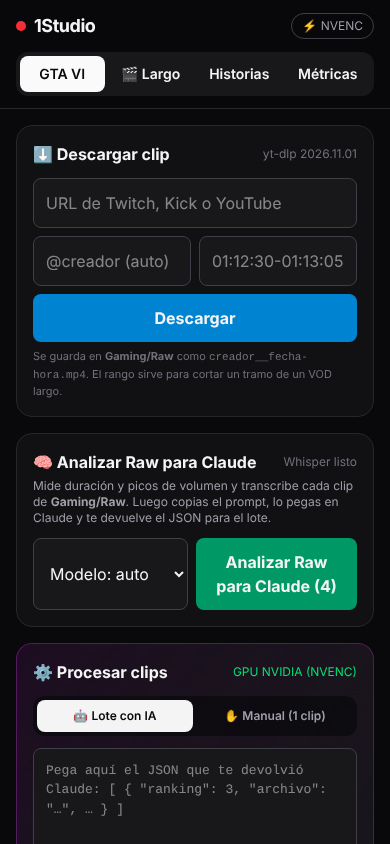
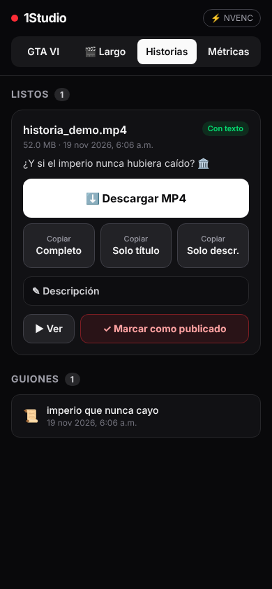
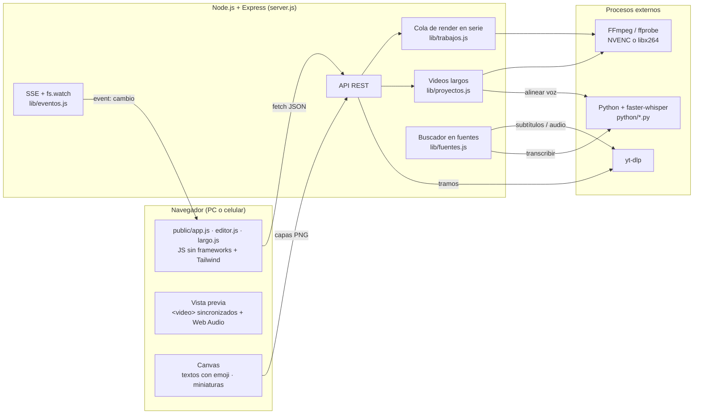
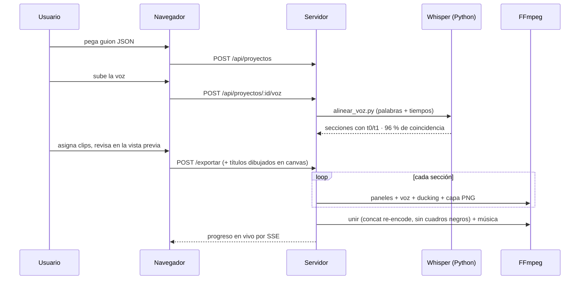

# 1Studio

**Un tablero local para producir videos: clips verticales, recopilaciones y videos largos armados en torno a una voz.**
Node.js + Express, FFmpeg (con aceleración NVENC) y Whisper. Se usa desde la PC y desde el celular en la misma red Wi-Fi.

*[English version below](#english)*



---

## ¿Qué problema resuelve?

Producir contenido corto y largo para YouTube, TikTok e Instagram implica muchas tareas repetitivas: descargar material, recortar, poner textos, sincronizar con la narración, exportar en varios formatos, copiar títulos y descripciones al celular y llevar las métricas.
1Studio junta todo ese flujo en una sola interfaz. Lo uso en producción para dos canales.

## Funciones principales

| | |
|---|---|
| **🎬 Videos largos armados en torno a la voz** | Pegas un guion en JSON y subes **una sola** narración. Whisper la transcribe palabra por palabra y la alinea con el guion (coincidencia difusa con `difflib`), así cada sección dura exactamente lo que dura su parte de la voz. Exporta el video 16:9 con capítulos y `.srt`, y un short vertical por sección con subtítulos palabra por palabra. |
| **👁 Vista previa en vivo** | Reproduce voz, clips, títulos y música **sin renderizar**. Simula en el navegador el *ducking* del render (la música y el sonido de los clips bajan cuando hablas) usando Web Audio (`AnalyserNode` → RMS → ganancia con la misma fórmula del `sidechaincompress` de FFmpeg). |
| **🔎 Buscador en fuentes** | Agregas links de VODs o videos largos. Se transcriben una vez (subtítulos de YouTube si existen; si no, solo el audio + Whisper por pedazos de 10 min) y luego buscas *"lo que dijo el streamer"*. Con un clic descargas solo ese tramo (`yt-dlp --download-sections`). |
| **⚙️ Procesador de clips** | Clips verticales 1080×1920 desde fuentes horizontales, cuadradas o verticales: fondo difuminado, gancho arriba, crédito abajo, estilo "lista que se descubre", emojis (texto dibujado en `<canvas>`), normalización a −14 LUFS. Cola en serie con progreso en vivo. |
| **🖼 Miniaturas** | Compositor 1280×720 en canvas: eliges un cuadro de cada clip, texto que se ajusta solo, división diagonal y "VS". |
| **📱 Del PC al celular** | Desde el celular descargas el MP4 y copias título y descripción con un toque. Al marcar un video como publicado se registra en métricas y el archivo va a la Papelera. |

<p align="center">
  
  
</p>
<p align="center">
  
  
</p>
<p align="center">
  
  
</p>

> Las capturas usan datos y videos de demostración generados con FFmpeg (`mandelbrot`, `life`, `gradients`).

## Arquitectura



**Flujo de un video largo**



### Decisiones técnicas que vale la pena mencionar

- **Sin frameworks en el frontend.** La UI se vuelve a pintar con *template strings*, pero hay refrescos parciales que no reinician videos ni campos mientras escribes (`conservarVideos`, `montarLargo(true)`). El estado vive en objetos simples (`S`, `LG`, `PV`).
- **Textos en canvas, no en `drawtext`.** FFmpeg no dibuja emojis de color. El navegador dibuja cada capa de texto como PNG transparente y el servidor la superpone con `overlay`.
- **Unir sin cuadros negros.** El *concat demuxer* con `-c copy` dejaba milisegundos negros entre segmentos con distinto GOP. Se cambió a `concat` como filtro, con re-codificación a FPS fijo.
- **GPU con respaldo en CPU.** Al iniciar prueba `h264_nvenc` con un video sintético de 0.2 s; si falla, usa `libx264`. Whisper hace lo mismo con CUDA → CPU.
- **Audio por FFmpeg, no por PyAV.** faster-whisper decodifica con PyAV y una versión rompía la API (`metadata_errors`). Ahora el audio se decodifica con FFmpeg a `float32` y se pasa como arreglo de NumPy.
- **Recorte automático de bordes negros** (`cropdetect`) solo cuando el resultado es razonable (quita entre 1.5 % y 45 % de la imagen).
- **Escrituras seguras.** El JSON se guarda de forma atómica (`.tmp` + `rename`). Las descripciones guardan respaldo de la versión anterior, y "Guardar" solo manda los campos que editaste, para no pisar datos con una pestaña vieja.
- **Tiempo real barato.** SSE con *debounce* de 350 ms, `fs.watch` sobre las carpetas de trabajo y *polling* de respaldo en el cliente.

## Estructura

```
server.js            API HTTP + arranque
lib/
  config.js          rutas, carpetas y variables de entorno (.env opcional)
  util.js            errores HTTP, rutas seguras, JSON atómico, procesos, papelera
  eventos.js         Server-Sent Events + fs.watch
  herramientas.js    detección de yt-dlp y Python/faster-whisper
  ffmpeg.js          NVENC/CPU, layouts vertical y lista, render de clips, unión
  trabajos.js        cola de render: clip manual, lote, recopilación tipo Top
  descargas.js       yt-dlp con tramos parciales y progreso
  analizador.js      análisis de clips (picos + transcripción) y prompt para el modelo de IA
  proyectos.js       videos largos: guion → voz → alineación → export
  fuentes.js         buscador en VODs: subtítulos/Whisper + búsqueda por palabras
python/
  analizar_raw.py        picos de volumen + transcripción por clip
  alinear_voz.py         alinea la voz con el guion palabra por palabra
  transcribir_fuente.py  transcripción por pedazos para VODs de horas
public/              index.html · app.js · editor.js · largo.js
test/                pruebas con node:test
```

## Cómo correrlo

Requisitos: **Node.js 18+** y **FFmpeg** en el PATH. Opcionales: **yt-dlp** (descargas) y **Python 3.10+** con `faster-whisper` (transcripción y alineación).

```bash
npm install
npm start          # http://localhost:3000 · también muestra la IP para abrirlo desde el celular
npm test           # 26 pruebas: utilidades, guion, subtítulos, búsqueda, frontend y servidor
```

En Windows, `INICIAR.bat` lo prepara todo: instala dependencias, descarga yt-dlp, instala faster-whisper (y las librerías CUDA si hay GPU NVIDIA) y arranca el servidor.

La configuración está en `.env.example`: nombres de los canales, carpetas de trabajo y rutas a FFmpeg, yt-dlp y Python.

## API (resumen)

| Método | Ruta | Para qué |
|---|---|---|
| GET | `/api/estado` | carpetas, archivos, herramientas detectadas y trabajos activos |
| GET | `/api/eventos` | SSE: avisa cuando algo cambia |
| POST | `/api/procesar` · `/api/lote` | encola renders de clips |
| POST | `/api/clips/descargar` | descarga un video o un tramo (`01:12:30-01:13:05`) |
| POST | `/api/proyectos` · `/:id/voz` · `/:id/exportar` | flujo de video largo |
| PUT | `/api/proyectos/:id/secciones` · `/:id/audio` | guarda clips, volúmenes y música |
| POST | `/api/fuentes` · `/api/fuentes/buscar` | agrega VODs y busca frases dentro de ellos |
| POST | `/api/publicar/:canal/:video` | marca como publicado → métricas + papelera |

## Uso responsable

La herramienta descarga y edita video. Úsala solo con material que te pertenece, que tienes permiso de usar o que está permitido por las reglas del dueño (por ejemplo, campañas de *clipping* o gameplay que el estudio permite compartir). Da crédito a los creadores y respeta las políticas de cada plataforma.

## Créditos

Desarrollado con apoyo de IA (Claude) como *pair programmer*: el diseño del flujo, las decisiones y las pruebas en uso real son mías.
Licencia MIT.

---

<a name="english"></a>
## English

**1Studio** is a local dashboard for video production: vertical clips, compilations and long-form videos built around a single voice-over. Node.js + Express, FFmpeg (NVENC-accelerated) and Whisper; usable from desktop and from a phone on the same Wi-Fi.

**Highlights**
- **Voice-driven long-form videos:** paste a JSON script, upload one narration; Whisper word timestamps are fuzzy-aligned to the script so every section lasts exactly as long as its part of the voice. Exports a 16:9 video with chapters + `.srt`, plus one vertical short per section with word-by-word captions.
- **Live preview without rendering:** synchronized `<video>` panels, title overlays and music; ducking is simulated in the browser with Web Audio (RMS → gain using the same curve as FFmpeg's `sidechaincompress`).
- **Search inside VODs:** sources are transcribed once (YouTube captions or audio + chunked Whisper); search for what the streamer said and fetch just that segment with `yt-dlp --download-sections`.
- **Clip processor:** 1080×1920 verticals from any aspect ratio, canvas-rendered text layers (emoji support), −14 LUFS loudness, serial render queue with live progress over SSE.
- **Thumbnail composer** in canvas (1280×720) and a phone-friendly publishing flow (download, copy title and description, mark as published → metrics).

**Engineering notes:** framework-free UI with partial re-renders that keep videos and inputs intact; NVENC → libx264 and CUDA → CPU fallbacks; concat via filter (re-encode) to avoid black frames between segments; automatic black-border removal via `cropdetect`; atomic JSON writes with backups; FFmpeg-decoded audio for Whisper to avoid a PyAV API break.

**Run:** `npm install && npm start` (requires Node 18+ and FFmpeg; yt-dlp and Python + faster-whisper are optional). `npm test` runs 26 tests with `node:test`.

Built with AI assistance (Claude) as a pair programmer. MIT License.
